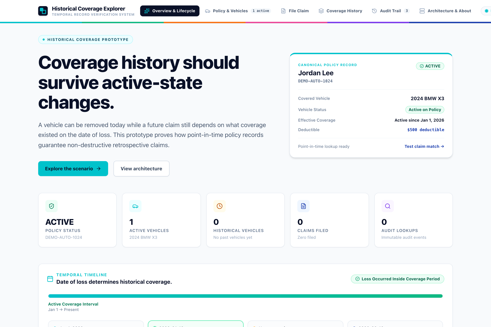
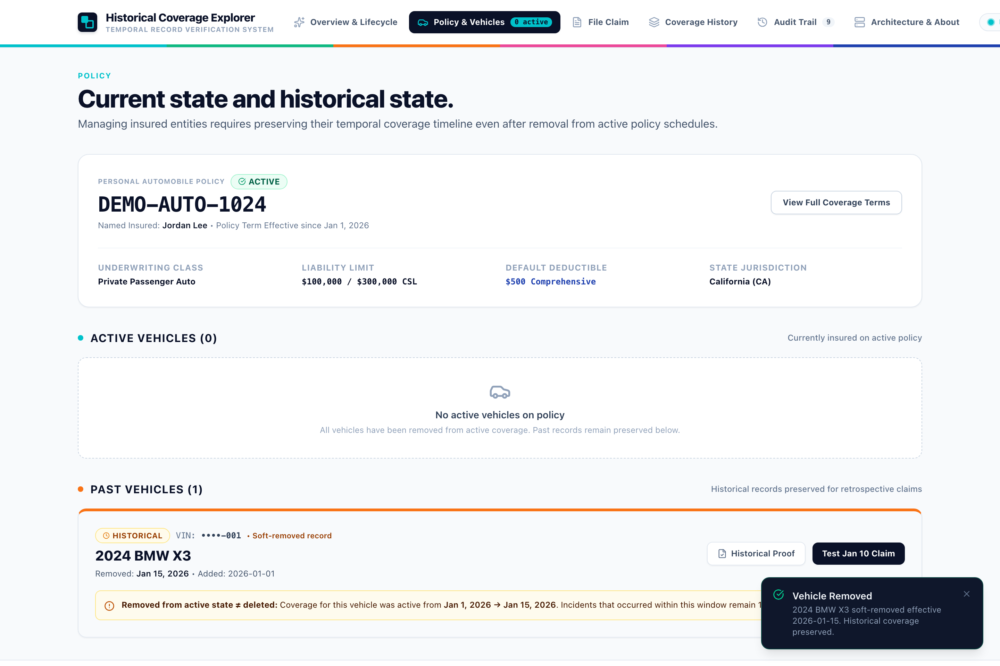
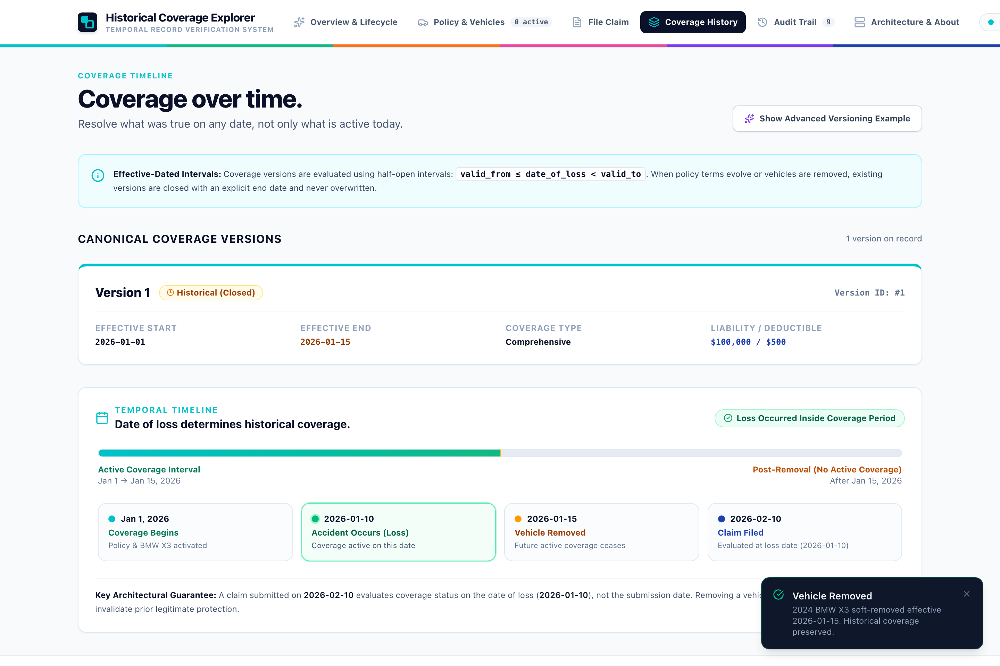
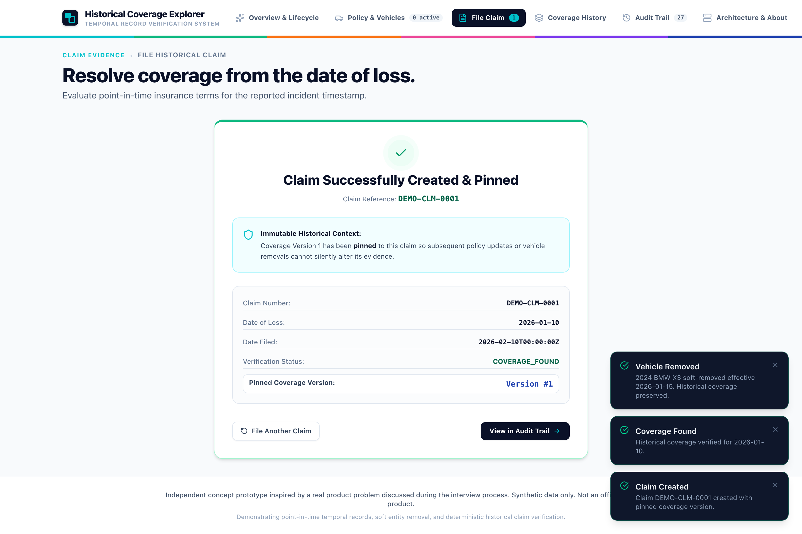
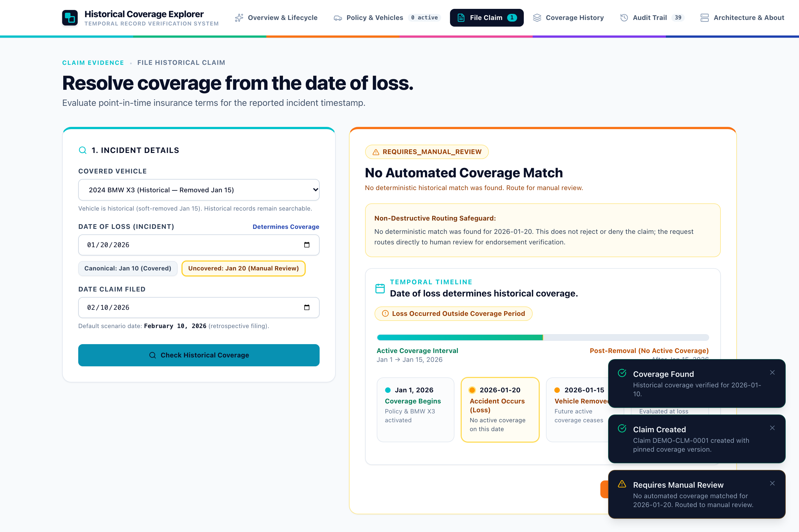
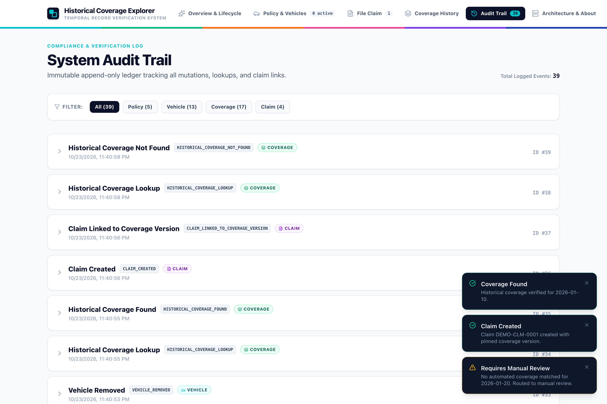
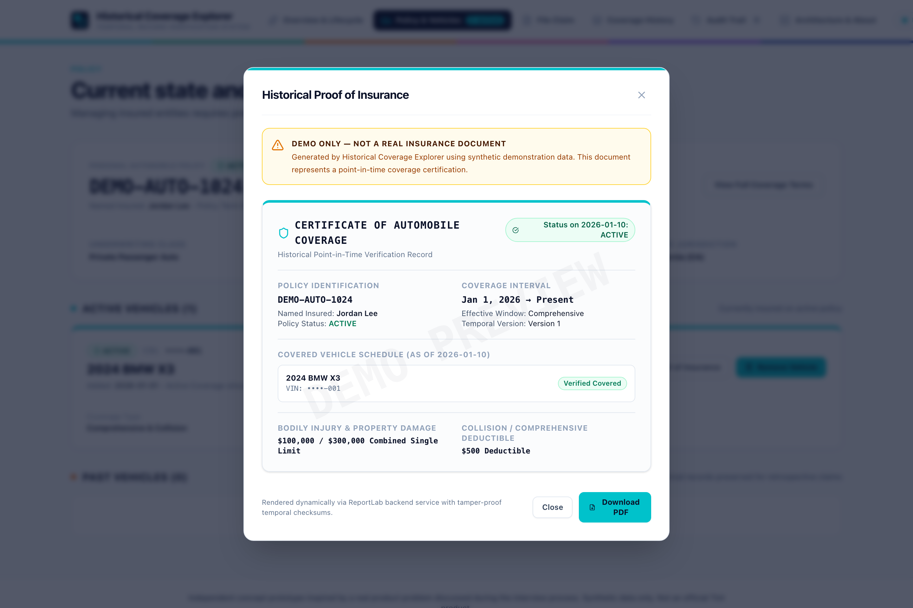
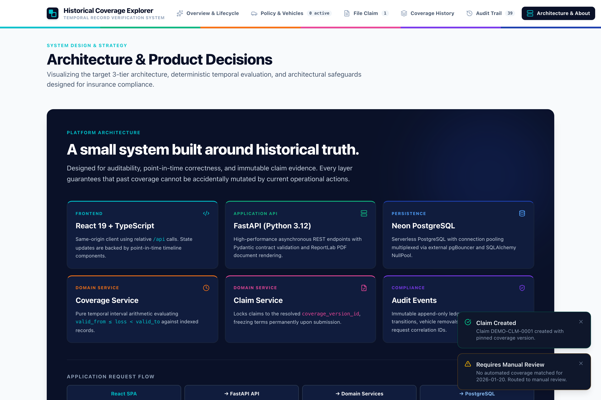
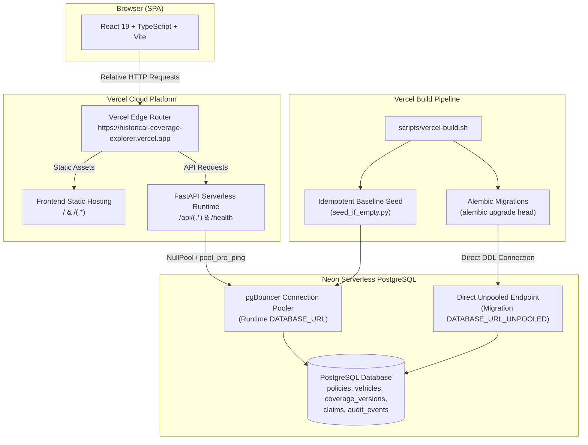

# Historical Coverage Explorer

> **Effective-Dated Insurance Coverage Prototype**
> *A product-engineering thought exercise solving point-in-time policy adjudication, soft vehicle removal, and immutable claim evidence pinning.*

[](https://historical-coverage-explorer.vercel.app)
[](https://neon.tech)
[](https://fastapi.tiangolo.com)
[](https://react.dev)

> **Verified Suite:** 58 automated test cases: 39 backend, 14 frontend, 5 Playwright E2E, plus a separate 12-step public deployment verification.

---

### 🌐 Quick Links
- **Live Production Application:** [https://historical-coverage-explorer.vercel.app](https://historical-coverage-explorer.vercel.app)
- **Interactive Swagger API Docs:** [https://historical-coverage-explorer.vercel.app/api/docs](https://historical-coverage-explorer.vercel.app/api/docs)
- **Product Case Study:** [docs/11-product-case-study.md](docs/11-product-case-study.md)
- **Technical Deep Dive:** [docs/12-technical-deep-dive.md](docs/12-technical-deep-dive.md)
- **Interviewer Demo Guide:** [docs/13-demo-guide.md](docs/13-demo-guide.md)
- **System Architecture:** [docs/03-architecture.md](docs/03-architecture.md)

---

> ⚠️ **Independent Prototype Disclaimer**
> *This repository is an independent concept prototype inspired by a product-engineering problem discussed during the interview process. It uses 100% synthetic data and does not represent any company's proprietary architecture, internal systems, data, or business processes. It is not an official Tint product and does not perform real-world financial underwriting or claim adjudication.*

---

## The Problem

In embedded insurance and commercial fleet platforms, vehicles are frequently added and removed from active policies. A customer might replace a delivery van on Tuesday, update their fleet roster on Wednesday, and file an accident claim three weeks later.

When this happens, traditional "current-state" database architectures break:

```text
Monday:    Accident occurs (Date of Loss) ──────► Vehicle was covered
Wednesday: Customer removes vehicle from fleet ──► Status becomes inactive
3 Weeks:   Customer files a claim ──────────────► System checks current fleet:
                                                  "Vehicle not found" ──► Unjustified Denial!
```

If the claims adjudication engine only queries current active inventory, legitimate claims are erroneously denied, operational teams face stressful escalation cycles, and insurance carriers risk regulatory non-compliance.

In insurance, **the date of loss determines coverage, not the claim filing date or current active fleet state**.

This prototype proves how to structure insurance policy management using **effective-dated temporal modeling**, **soft operational removal**, and **immutable claim pinning** so historical truth survives operational changes.

---

## Canonical Scenario

The application implements a canonical demonstration journey for customer **Jordan Lee** and policy **`DEMO-AUTO-1024`**:

| Date | Event | System State |
| :--- | :--- | :--- |
| **Jan 1, 2026** | Coverage begins | 2024 BMW X3 active with Comprehensive coverage ($500 deductible, $100K liability). |
| **Jan 10, 2026** | **Accident occurs (Date of Loss)** | Incident takes place while the vehicle is fully active. |
| **Jan 15, 2026** | Customer removes BMW | Vehicle is soft-removed from active fleet; active coverage version is closed at Jan 15. Historical records are preserved. |
| **Feb 10, 2026** | Customer files claim | Claim submitted for the Jan 10 incident. |

### Expected Outcomes
1. **Retrospective Evaluation (Jan 10):** The system evaluates Jan 10, finds that Coverage Version 1 governed on that date, and returns **`COVERAGE_FOUND`**. Submitting the claim generates Claim #1001 and permanently pins Coverage Version 1.
2. **Post-Removal Boundary Evaluation (Jan 20):** If an incident occurred on Jan 20 (after removal), the system finds no active coverage and returns **`REQUIRES_MANUAL_REVIEW`**. It **never** executes an automated denial (`DENIED`).

---

## Product Approach

1. **Effective-Dated Temporal Versioning:** Coverage terms are modeled using half-open intervals `[valid_from, valid_to)`, where `valid_from` is inclusive and `valid_to` is exclusive. `valid_to = NULL` represents open-ended current coverage. Every point in continuous time maps to exactly one version.
2. **Soft Fleet Removal:** Removing a vehicle updates `removed_at = effective_date` and bounds active coverage, but never deletes database records.
3. **Date-of-Loss Lookup:** Coverage eligibility is resolved dynamically against the incident date, completely independent of when the claim is filed.
4. **Immutable Claim Pinning:** Filing a claim writes a foreign key `coverage_version_id` to the claim record. Even if the policyholder cancels their policy later, the claim's legal context remains permanently frozen.
5. **No Automated Denial:** When a date has no match, the system routes the claim to `REQUIRES_MANUAL_REVIEW`. Automated rejections create unacceptable brand and legal risk.
6. **Deterministic SQL Decision Path:** Coverage resolution is executed by deterministic relational SQL queries. No AI/LLMs exist in the policy adjudication loop.
7. **Durable Business Auditability:** All lifecycle mutations persist to a PostgreSQL JSONB audit ledger, completely isolated from transient server logs.

---

## Live Product Interface

The prototype features a custom, high-contrast editorial interface inspired by modern fintech and embedded insurance design principles:

### 1. Executive Dashboard & Narrative Timeline

*Final prototype interface: Overview hero displaying Jordan Lee's active policy card, canonical lifecycle narrative, and dark infrastructure feature section.*

---

### 2. Active Policy vs. Preserved Historical Fleet

*Policy view following soft removal: The 2024 BMW X3 transitions to 'Past Vehicles' with an explicit HISTORICAL badge, proving that removal from the active fleet does not destroy historical terms.*

---

### 3. Coverage Over Time & Deductible Comparison

*Coverage Timeline displaying effective-dated intervals as colored temporal bands, enabling point-in-time term inspection and deductible comparisons ($1,000 vs. $500).*

---

### 4. Deterministic Claim Resolution & Evidence Pinning

*File Claim view: Evaluating Jan 10 date of loss returns COVERAGE_FOUND with $500 deductible, generating Claim #1001 with permanently pinned Coverage Version 1.*

---

### 5. Safe Failure Mode: Post-Removal Manual Review

*Evaluating an incident on Jan 20 (post-removal): The system returns REQUIRES_MANUAL_REVIEW in warm amber, safely routing to adjusters with zero automated claim denial.*

---

### 6. Durable Immutable Audit Ledger

*Audit Trail: Immutable PostgreSQL JSONB domain events recording every lifecycle transition with category filters and raw metadata inspection.*

---

### 7. Point-in-Time Proof of Insurance

*Dynamically generated Proof of Insurance document with live in-memory ReportLab PDF download. Note: This is a synthetic demo coverage document with prominent watermarks and is not legally valid proof of insurance.*

---

### 8. System Architecture Canvas

*Architecture view visualizing the multi-service runtime execution flow and the deterministic claim pinning lifecycle.*

---

## System Architecture



---

## Data Model

```
┌─────────────────────────┐         ┌─────────────────────────┐
│        policies         │1       *│        vehicles         │
├─────────────────────────┤─────────┼─────────────────────────┤
│ id: BIGSERIAL (PK)      │         │ id: BIGSERIAL (PK)      │
│ policy_number: VARCHAR  │         │ policy_id: BIGINT (FK)  │
│ customer_name: VARCHAR  │         │ vin: VARCHAR (Masked)   │
│ status: VARCHAR         │         │ make / model / year     │
│ created_at / updated_at │         │ added_at: DATE          │
└─────────────────────────┘         │ removed_at: DATE (NULL) │
             │                      └─────────────────────────┘
             │                                   │
             │1                                  │1
             │                                   │
             │       ┌───────────────────┐       │
             └──────*│ coverage_versions │*──────┘
                     ├───────────────────┤
                     │ id: BIGSERIAL (PK)│
                     │ policy_id: BIGINT │
                     │ vehicle_id: BIGINT│
                     │ valid_from: DATE  │
                     │ valid_to: DATE    │ (NULL = current)
                     │ coverage_type     │
                     │ deductible        │
                     │ liability_limit   │
                     │ version_label     │
                     └───────────────────┘
                               ▲
                               │ 1 (Pinned Version)
                               │ [ON DELETE RESTRICT]
                     ┌───────────────────┐
                     │      claims       │
                     ├───────────────────┤
                     │ id: BIGSERIAL (PK)│
                     │ claim_number: STR │
                     │ policy_id: BIGINT │
                     │ vehicle_id: BIGINT│
                     │ coverage_ver_id   │
                     │ date_of_loss: DATE│
                     │ status: 'FILED'   │
                     └───────────────────┘
```

### Relational Safety Guarantees
- **Half-Open Intervals:** `valid_from <= date_of_loss < valid_to` ensures unambiguous continuous coverage.
- **`ON DELETE RESTRICT`:** Database foreign keys prevent deletion of any `CoverageVersion` that has claims pinned to it.
- **Append-Only Audit Ledger:** The `audit_events` table captures every policy, vehicle, coverage, and claim event with actor tags and JSONB payloads.

---

## API Reference

The live API is documented interactively via OpenAPI / Swagger at:
👉 **[https://historical-coverage-explorer.vercel.app/api/docs](https://historical-coverage-explorer.vercel.app/api/docs)**

| Method | Endpoint | Description |
| :--- | :--- | :--- |
| `GET` | `/health` | System health probe verifying PostgreSQL connectivity (`status: "ok"`). |
| `GET` | `/api/policies/{id}` | Retrieve complete policy record with active and historical vehicles. |
| `POST` | `/api/vehicles/{id}/remove` | Soft-remove a vehicle effective on a specified date. |
| `GET` | `/api/coverage/lookup` | Query governing coverage for a vehicle on a specific date of loss. |
| `POST` | `/api/claims` | File a new claim and permanently pin governing `coverage_version_id`. |
| `GET` | `/api/coverage/{id}/proof.pdf` | Generate in-memory PDF proof of insurance (synthetic demo document; not legally valid proof of insurance). |
| `GET` | `/api/audit-events` | Retrieve immutable audit event history with optional category filters. |
| `POST` | `/api/demo/reset` | Reset synthetic demonstration data back to canonical baseline. |

---

## Testing & Verification

The project is backed by a multi-layered automated verification suite:

```
               ┌─────────────────────────────┐
               │    Playwright E2E (5/5)     │   Full browser journeys
               ├─────────────────────────────┤
               │   Frontend Vitest (14/14)   │   RTL component interactions
               ├─────────────────────────────┤
               │   Backend Pytest (39/39)    │   Domain logic & API contracts
               └─────────────────────────────┘
```

- **58 automated test cases: 39 backend, 14 frontend, 5 Playwright E2E, plus a separate 12-step public deployment verification.**
- **88% Aggregate Backend Coverage** (with core domain and claims services exceeding 90%).
- **Dedicated E2E Database Safety Guard:** Test suites enforce a strict safety check requiring `test` in the database name before running truncation or setup routines.
- **Boundary-Date Testing:** Validates inclusive `valid_from`, exclusive `valid_to`, day-before, day-of, and post-removal evaluation.
- **12-Step Public Deployment Smoke Suite:** An automated script (`scripts/verify-vercel-deployment.mjs`) verifies live production health, soft removal, claim pinning, PDF generation, and versioned scenarios directly against `historical-coverage-explorer.vercel.app`.
- **Additional Production Validation — Redeploy Persistence:** Tested separately from the 12 scripted smoke steps; confirmed that soft vehicle removals and pinned claims survive complete Vercel redeployments.

---

## Observability & Diagnostics

1. **Structured JSON Logs:** All backend requests emit machine-readable JSON logs to stdout containing correlation IDs, request path, HTTP method, status, duration ms, and client IP.
2. **Correlation IDs:** Propagated via `X-Correlation-ID` headers across all API requests, responses, and log traces.
3. **Sensitive Data Protection:** VINs are automatically masked in user-facing logs and views (`••••-001`).
4. **Separation of Concerns:** Ephemeral operational diagnostic logs (stdout) are strictly decoupled from durable business history (`audit_events` PostgreSQL table).

---

## Production Cloud Deployment

- **Hosting:** Vercel Multi-Service Project ([`vercel.json`](vercel.json)).
- **Database:** Neon Serverless PostgreSQL with managed pgBouncer.
- **Serverless Pooling:** Configured with SQLAlchemy `NullPool` and `pool_pre_ping=True` to prevent connection exhaustion in serverless environments.
- **Migration Safety:** Alembic runs automatically during Vercel production builds using Neon's direct `DATABASE_URL_UNPOOLED` connection.
- **Non-Destructive Seeding:** Production builds execute `seed_if_empty.py`, which checks for existing records and acts as a strict no-op if data is present.

---

## Local Development

### Prerequisites
- Python 3.12+
- Node.js 22+
- PostgreSQL 14+ (or Docker)

### Quick Start via Docker Compose
```bash
cp .env.example .env
docker compose up --build
```
- Frontend: `http://localhost:5173`
- Backend API: `http://localhost:8000`
- Swagger Docs: `http://localhost:8000/api/docs`

### Manual Setup
```bash
# 1. Install dependencies
make setup

# 2. Run backend migrations
make db-upgrade

# 3. Start development servers
make dev
```

### Running Test Suites
```bash
make test          # Run all unit and integration tests
make test-backend  # Pytest with coverage
make test-frontend # Vitest / React Testing Library
make test-e2e      # Playwright browser journeys
```

---

## Documentation Index

| Document | Purpose | Target Audience |
| :--- | :--- | :--- |
| [Product Case Study](docs/11-product-case-study.md) | Business problem, requirements, tradeoffs, and product impact | Product Managers, Recruiters |
| [Technical Deep Dive](docs/12-technical-deep-dive.md) | Detailed temporal modeling, transaction boundaries, and cloud architecture | Engineering Leads, Architects |
| [Interviewer Demo Guide](docs/13-demo-guide.md) | 3–5 minute live presentation script, screen guide, and Q&A | Interviewers, Presenters |
| [Deployment Architecture](docs/10-deployment.md) | Vercel multi-service, Neon connection pooling, and build pipeline | DevOps, SREs |
| [System Architecture](docs/03-architecture.md) | System components, sequence diagrams, and technology choices | Technical Reviewers |
| [Testing Strategy](docs/08-testing-strategy.md) | Test pyramid, boundary matrices, and test database safety guards | QA, Engineers |
| [Architecture Decision Records](docs/decisions/) | 7 formal ADRs documenting key engineering decisions | Architects, Engineers |

---

## What I Would Explore Next

If taking this concept toward enterprise production, key future roadmap items include:
1. **Multi-Vehicle Commercial Endorsements:** Modeling bulk mid-term endorsements across entire commercial fleets with retroactive rate adjustments.
2. **Carrier-Specific Policy Packets:** Templatized document assembly matching state-specific ACORD insurance certificate standards.
3. **Idempotency Keys:** Enforcing client-supplied `Idempotency-Key` headers on claim and removal endpoints to prevent duplicate submissions during network retries.
4. **Timezone-Aware Statutory Inception:** Supporting statutory 12:01 AM local time boundary rules across multi-state operating zones.
5. **Adjuster Operations Console:** Building dedicated triage and adjudication workflows for claims routed to `REQUIRES_MANUAL_REVIEW`.

---

## Disclaimer

This software is an educational prototype built with synthetic data. Fictional names (`Jordan Lee`), policy numbers (`DEMO-AUTO-1024`), and VINs (`DEMO-VIN-001`) are used exclusively for demonstration. This application does not represent any company's proprietary technology or underwriting architecture and is not an official Tint product.
