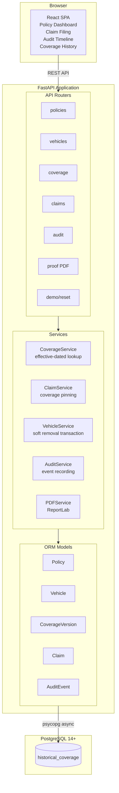
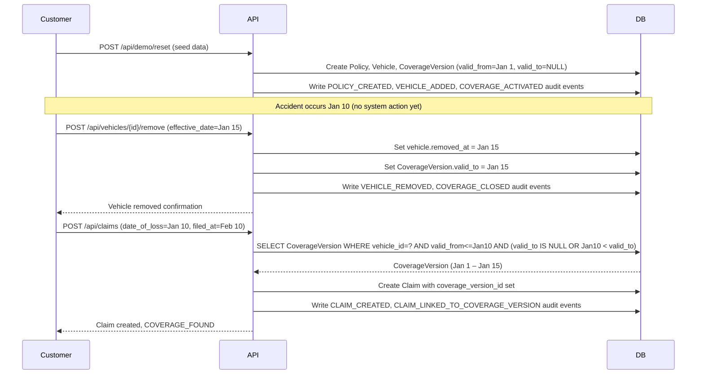

# Architecture

> **Prototype:** Historical Coverage Explorer
> **Document:** docs/03-architecture.md
> **Status:** Phase 3 Complete

---

## Overview

The Historical Coverage Explorer is a monorepo prototype with three layers:

1. **Frontend** — React + TypeScript + Vite SPA
2. **Backend** — Python FastAPI REST API
3. **Database** — PostgreSQL 14+ (psycopg async driver, SQLAlchemy 2.x; validated locally on 14; Docker Compose targets 16)

All three run locally via Docker Compose or natively via Makefile.

---

## Implemented Architecture (Phase 3)

---

## Coverage Lifecycle Diagram

---

## Key Architectural Decisions

| Decision | Choice | See ADR |
|----------|--------|---------|
| Historical source of truth | Effective-dated DB records (not cache) | ADR-001 |
| Vehicle removal | Soft delete (set removed_at) | ADR-002 |
| Claim coverage reference | Pin to coverage_version_id at creation | ADR-003 |
| Coverage determination | Deterministic SQL query (no AI) | ADR-004 |
| Logging vs. audit | Separate concerns: app logs vs. audit events | ADR-005 |

---

## Layer Responsibilities

### Frontend (`apps/frontend/`)

| File/Folder | Purpose |
|-------------|---------|
| `src/lib/api.ts` | API abstraction layer — all backend calls go here |
| `src/App.tsx` | Root application component |
| `src/index.css` | Global Tailwind + design tokens |

> **Design principle:** All backend calls go through `src/lib/api.ts`. Mock data (Phase 2) and real API calls (Phase 3) swap at this boundary.

### Backend (`apps/backend/app/`)

| Module | Purpose |
|--------|---------|
| `main.py` | FastAPI application, CORS, lifespan |
| `core/config.py` | pydantic-settings — reads .env |
| `db/base.py` | SQLAlchemy DeclarativeBase |
| `db/session.py` | Async engine, session factory, startup check |
| `api/routers/health.py` | GET /health endpoint |
| `models/` | ORM models (Phase 3) |
| `schemas/` | Pydantic request/response schemas (Phase 3) |
| `services/` | Business logic (Phase 3) |

### Database

PostgreSQL 14+ (validated locally on PostgreSQL 14; Docker Compose targets PostgreSQL 16). Migrations via Alembic.

---

## What Is Implemented (Phase 1)

- [x] Monorepo structure
- [x] FastAPI application with CORS
- [x] `GET /health` endpoint (includes DB connectivity check)
- [x] SQLAlchemy 2.x async engine configuration
- [x] pydantic-settings configuration
- [x] Alembic initialized and configured to use app's DATABASE_URL and Base
- [x] React + TypeScript + Vite frontend skeleton
- [x] Tailwind CSS configured
- [x] API abstraction layer (`src/lib/api.ts`)
- [x] Docker Compose with PostgreSQL, backend, frontend
- [x] `.env.example`
- [x] Makefile

## What Is Proposed (Phase 3)

- [ ] ORM models: Policy, Vehicle, CoverageVersion, Claim, AuditEvent
- [ ] Alembic migrations
- [ ] Vehicle removal transaction
- [ ] Effective-dated coverage lookup query
- [ ] Claim creation with coverage pinning
- [ ] Audit event recording
- [ ] Proof-of-insurance PDF generation
- [ ] Demo seed/reset endpoint
- [ ] Full frontend/backend integration

## Deliberately Out of Scope

- Real carrier API integrations
- Authentication / OAuth
- Authorization / RBAC
- Payment processing
- Real customer data
- Production security hardening
- Kubernetes / microservices
- Event streaming (Kafka, Debezium)
- Machine learning / LLMs for coverage determination
