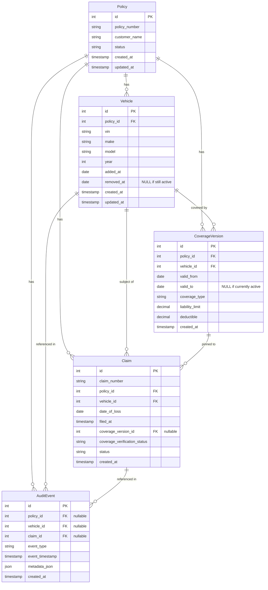

# Data Model

> **Prototype:** Historical Coverage Explorer
> **Document:** docs/04-data-model.md
> **Status:** Phase 3 (Implemented in PostgreSQL 14+ via Alembic migration `e1aeef35ef22`; validated locally on 14; Docker Compose targets 16)

---

## Overview

The data model is designed around one core principle: **the historical record of coverage is separate from and survives changes to the active policy.**

No record is hard-deleted. Removal is signaled by setting a date field.

---

## Entity Relationship Diagram

---

## Entities

### Policy

Represents a customer's insurance policy.

| Field | Type | Notes |
|-------|------|-------|
| `id` | integer (PK) | Auto-increment |
| `policy_number` | string | Human-readable. Demo: `DEMO-AUTO-1024` |
| `customer_name` | string | Demo: `Jordan Lee` (synthetic) |
| `status` | string | `ACTIVE` \| `CANCELLED` \| `EXPIRED` |
| `created_at` | timestamp (UTC) | |
| `updated_at` | timestamp (UTC) | |

---

### Vehicle

Represents an insured vehicle. **Never hard-deleted.**

| Field | Type | Notes |
|-------|------|-------|
| `id` | integer (PK) | Auto-increment |
| `policy_id` | integer (FK → Policy) | |
| `vin` | string | Demo: `DEMO-VIN-001` (synthetic — not a real VIN) |
| `make` | string | Demo: `BMW` |
| `model` | string | Demo: `X3` |
| `year` | integer | Demo: `2024` |
| `added_at` | date | Date vehicle was added to policy |
| `removed_at` | date \| NULL | NULL if still active. Set on removal. |
| `created_at` | timestamp (UTC) | |
| `updated_at` | timestamp (UTC) | |

> **Rule:** A vehicle is considered active if `removed_at IS NULL`.
> The active policy view filters by `removed_at IS NULL`.
> Historical views query without this filter.

---

### CoverageVersion

The **source of truth** for historical coverage. Each version represents a specific period of coverage for a vehicle.

| Field | Type | Notes |
|-------|------|-------|
| `id` | integer (PK) | Auto-increment |
| `policy_id` | integer (FK → Policy) | |
| `vehicle_id` | integer (FK → Vehicle) | |
| `valid_from` | date | Coverage begins (inclusive) |
| `valid_to` | date \| NULL | Coverage ends (exclusive). NULL = currently active. |
| `coverage_type` | string | `Comprehensive` \| `Liability` \| etc. |
| `liability_limit` | decimal | Demo: `100000.00` |
| `deductible` | decimal | Demo: `500.00` |
| `created_at` | timestamp (UTC) | |

> **Date boundary semantics:**
> A CoverageVersion is active on date `d` if:
> `valid_from <= d AND (valid_to IS NULL OR d < valid_to)`
>
> This makes `valid_to` **exclusive** — the vehicle was no longer covered on that date.
>
> Example: `valid_from = Jan 1`, `valid_to = Jan 15`
> - Active on Jan 10 ✅
> - Active on Jan 15 ❌ (exclusive end)
> - Active on Jan 20 ❌

---

### Claim

Represents a customer's insurance claim. The `coverage_version_id` is pinned at creation time and does not change.

| Field | Type | Notes |
|-------|------|-------|
| `id` | integer (PK) | Auto-increment |
| `claim_number` | string | Human-readable. Demo: `CLM-2026-001` |
| `policy_id` | integer (FK → Policy) | |
| `vehicle_id` | integer (FK → Vehicle) | |
| `date_of_loss` | date | **The critical date.** Used for coverage lookup. |
| `filed_at` | timestamp (UTC) | When the claim was submitted — **not** used for coverage lookup |
| `coverage_version_id` | integer (FK → CoverageVersion) \| NULL | Set at creation. NULL if no match found. |
| `coverage_verification_status` | string | `COVERAGE_FOUND` \| `NO_COVERAGE_FOUND` \| `REQUIRES_MANUAL_REVIEW` |
| `status` | string | `OPEN` \| `UNDER_REVIEW` \| `CLOSED` |
| `created_at` | timestamp (UTC) | |

> **Pinning rule:** After `coverage_version_id` is set on claim creation, it is never automatically changed. Future policy edits cannot silently alter a claim's coverage context.

---

### AuditEvent

A durable record of every material lifecycle event. Separate from application logs.

| Field | Type | Notes |
|-------|------|-------|
| `id` | integer (PK) | Auto-increment |
| `policy_id` | integer (FK → Policy) \| NULL | |
| `vehicle_id` | integer (FK → Vehicle) \| NULL | |
| `claim_id` | integer (FK → Claim) \| NULL | |
| `event_type` | string | See event type list below |
| `event_timestamp` | timestamp (UTC) | When the event occurred |
| `metadata_json` | JSON | Contextual details (no PII) |
| `created_at` | timestamp (UTC) | |

**Event Types:**

| Event Type | Triggered When |
|-----------|----------------|
| `POLICY_CREATED` | New policy seeded or created |
| `VEHICLE_ADDED` | Vehicle added to policy |
| `COVERAGE_ACTIVATED` | CoverageVersion created |
| `COVERAGE_CHANGED` | Coverage terms updated |
| `VEHICLE_REMOVAL_REQUESTED` | Removal API called |
| `VEHICLE_REMOVED` | Vehicle.removed_at set |
| `COVERAGE_CLOSED` | CoverageVersion.valid_to set |
| `HISTORICAL_COVERAGE_LOOKUP` | Coverage query executed |
| `HISTORICAL_COVERAGE_FOUND` | Coverage match found |
| `HISTORICAL_COVERAGE_NOT_FOUND` | No coverage match |
| `CLAIM_CREATED` | Claim record created |
| `CLAIM_LINKED_TO_COVERAGE_VERSION` | coverage_version_id set on claim |
| `PROOF_OF_INSURANCE_GENERATED` | PDF generation requested |

---

## Demo Seed Data

| Entity | Value |
|--------|-------|
| Policy number | `DEMO-AUTO-1024` |
| Customer name | `Jordan Lee` (synthetic) |
| Vehicle make/model | `2024 BMW X3` |
| VIN | `DEMO-VIN-001` (synthetic — not a real VIN) |
| Coverage type | `Comprehensive` |
| Liability limit | `$100,000` |
| Deductible | `$500` |
| Coverage start | `2026-01-01` |
| Coverage end | `2026-01-15` (set when vehicle removed) |

---

## Implementation Status

| Entity | Status |
|--------|--------|
| Policy | Proposed — Phase 3 |
| Vehicle | Proposed — Phase 3 |
| CoverageVersion | Proposed — Phase 3 |
| Claim | Proposed — Phase 3 |
| AuditEvent | Proposed — Phase 3 |
| Alembic migrations | Phase 3 |
